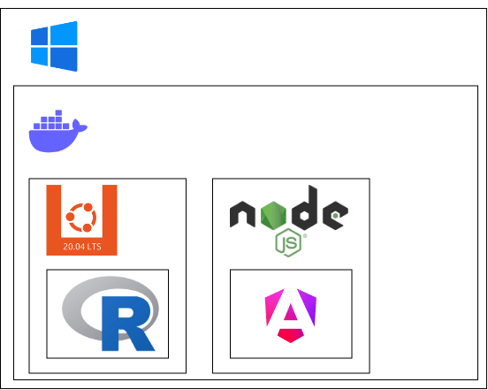
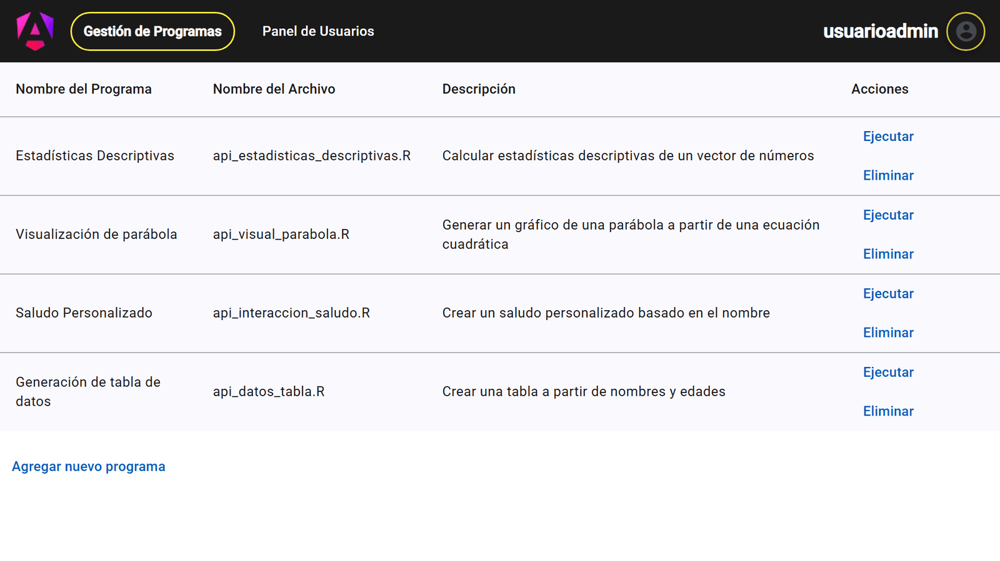
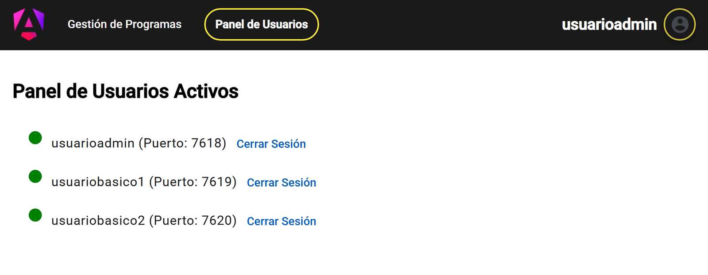
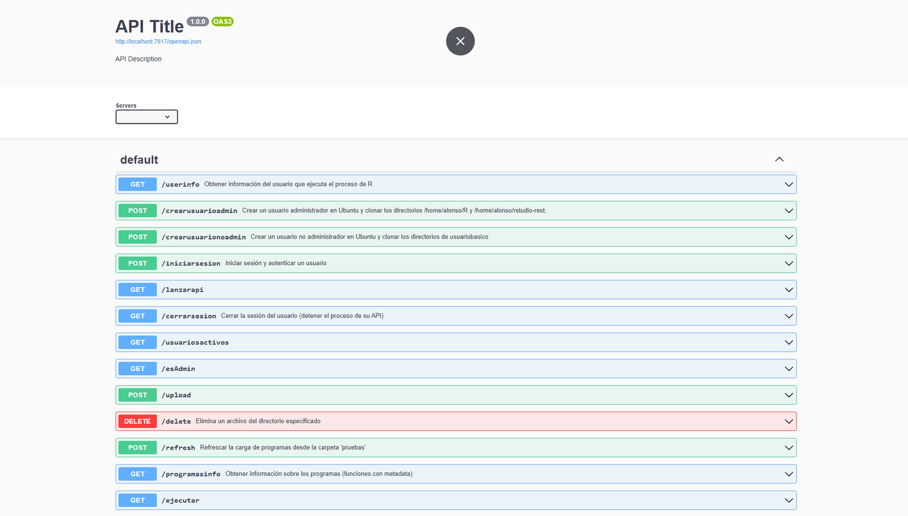
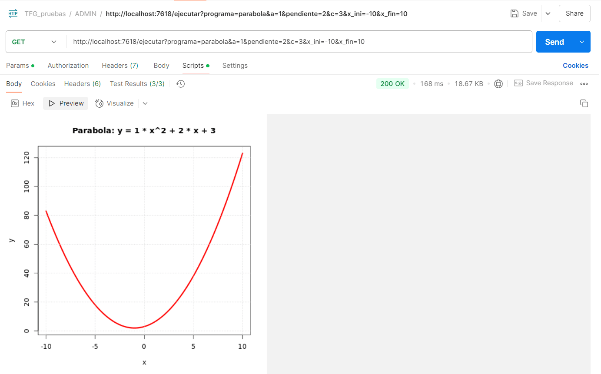
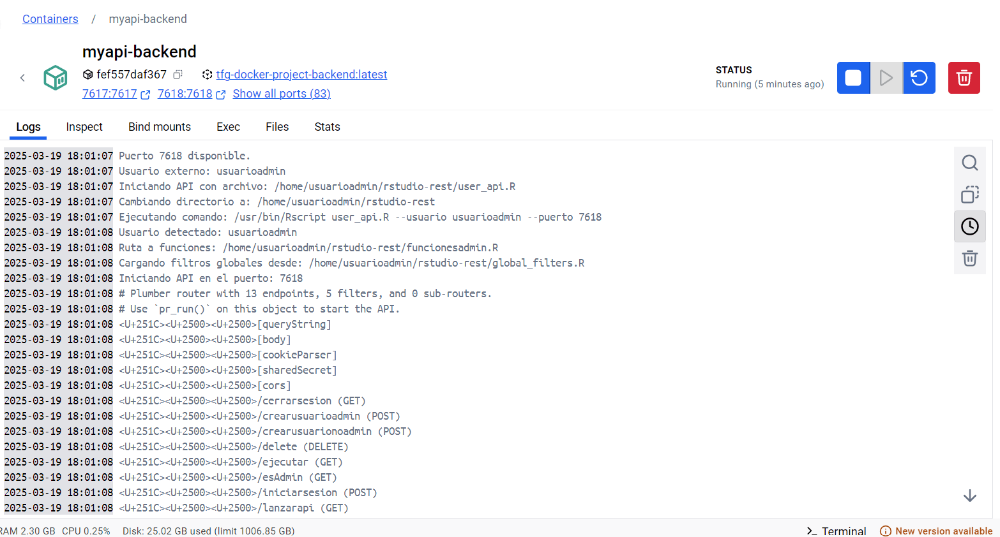

# Ejecución remota de programas R · TFG Ingeniería Informática (UCLM)

> **Demo pública:** [Abrir aplicación](https://alonsomarcosm.github.io/TFG_AlonsoMarcosMu-oz/)
>
> **Caso de estudio:** https://alonsomarcosm.github.io/es/projects/tfg-remote-r-scripts/


Trabajo Fin de Grado de Ingeniería Informática (UCLM). Es una aplicación web que
permite gestionar y ejecutar programas R desde el navegador sin instalar R ni
RStudio en el equipo del usuario. El frontend Angular habla con una API REST
escrita en R con **Plumber**. Cada usuario autenticado obtiene su propio proceso
de API, así que las ejecuciones de distintos usuarios quedan aisladas en puertos
y directorios separados.

Este repositorio contiene el **frontend Angular**, su contenedor y una
**demo estática** publicada en GitHub Pages. El backend R se entregó junto a la
memoria del TFG y no forma parte de este repositorio.

## Qué resuelve

Un equipo que trabaja con análisis en R suele depender de instalaciones locales
y de compartir scripts a mano. El sistema centraliza los programas R en un
servidor y los expone como servicios documentados. Cualquier usuario autorizado
puede lanzarlos desde una interfaz web, con parámetros validados y un resultado
legible.

- **Catálogo de programas:** cada script R declara sus metadatos (propósito,
  parámetros, método y resultado esperado). La interfaz los descubre mediante
  `/programasinfo` y genera el formulario de ejecución.
- **Ejecución con parámetros:** el resultado vuelve como tabla o como imagen,
  por ejemplo la gráfica de una parábola.
- **Gestión de programas:** alta mediante subida de ficheros `.R`, borrado y
  recarga del catálogo.
- **Usuarios y roles:** registro, inicio y cierre de sesión. Un panel de
  administración muestra los usuarios activos y el puerto de cada uno.

## Arquitectura



Docker Compose levanta dos contenedores en una red común:

| Contenedor | Contenido | Puertos |
| --- | --- | --- |
| `myapi-backend` | Ubuntu 20.04, R, Plumber y RStudio Server | `7617` API principal, `7618-7679` y `7681-7700` APIs por usuario |
| `angular-frontend` | Node.js 20 y Angular 19 (`ng serve`) | `4200` |

La **API principal** (`7617`) gestiona usuarios y sesiones. Al iniciar sesión,
lanza una **API Plumber dedicada** para ese usuario en uno de esos puertos
libres. A partir de ese momento, el frontend dirige a ese puerto las
llamadas de programas: listar, ejecutar, subir y borrar. Al cerrar la sesión se
detiene el proceso del usuario, así que no quedan procesos R ociosos.

### Autenticación y roles

La autenticación usa usuarios reales de Linux en lugar de un proveedor externo
como LDAP. Los scripts `crear_usuario.sh` y `crear_usuario_noadmin.sh` se
ejecutan con `sudo` desde la API y crean la cuenta con su estructura de
directorios. La diferencia entre administrador y usuario básico se gestiona en
el propio sistema operativo.

Tras autenticarse, la API devuelve un token de sesión aleatorio. El frontend lo
guarda con una caducidad y protege las rutas con un *guard* de Angular. Es un
enfoque deliberadamente sencillo, adecuado a la escala académica del proyecto.

## API REST

La API principal está documentada con **OpenAPI 3** (Swagger) y expone 13
endpoints:

| Método | Endpoint | Función |
| --- | --- | --- |
| `POST` | `/iniciarsesion` | Autenticar al usuario y abrir sesión |
| `GET` | `/lanzarapi` | Lanzar la API Plumber del usuario |
| `GET` | `/cerrarsesion` | Cerrar la sesión y detener su API |
| `GET` | `/esAdmin` | Consultar el rol del usuario |
| `GET` | `/userinfo` | Obtener el usuario que ejecuta el proceso R |
| `POST` | `/crearusuarioadmin` | Crear un usuario administrador |
| `POST` | `/crearusuarionoadmin` | Crear un usuario básico |
| `GET` | `/usuariosactivos` | Listar las sesiones activas y sus puertos |
| `GET` | `/programasinfo` | Listar los programas con sus metadatos |
| `POST` | `/refresh` | Recargar el catálogo de programas |
| `GET` | `/ejecutar` | Ejecutar un programa con parámetros |
| `POST` | `/upload` | Subir un programa `.R` |
| `DELETE` | `/delete` | Eliminar un programa |

Programas de ejemplo incluidos: estadísticas descriptivas, visualización de una
parábola, saludo personalizado y generación de una tabla de datos.

## Capturas

| Gestión de programas | Panel de usuarios activos |
| --- | --- |
|  |  |

| Endpoints en OpenAPI | Prueba en Postman |
| --- | --- |
|  |  |



## Demo pública

La publicación en GitHub Pages conserva la interfaz Angular completa sin exponer
el backend ni ejecutar código R recibido desde Internet. La configuración `demo`
activa `demo.interceptor.ts`, que responde a la lista cerrada de endpoints del
frontend con datos en memoria. Cualquier otra ruta devuelve 404.

Login, registro, subida, borrado y ejecución son interacciones simuladas en la
demo. El detalle está en [docs/portfolio_deployment.md](docs/portfolio_deployment.md).

## Desarrollo del frontend

```bash
cd proyecto
npm ci
npm start                                     # http://localhost:4200, requiere el backend en localhost:7617
npm test -- --watch=false --browsers=ChromeHeadless
npm run build -- --configuration demo         # demo estática sin backend
```

El workflow [`.github/workflows/pages.yml`](.github/workflows/pages.yml) ejecuta
los tests, construye la configuración `demo` y la publica en GitHub Pages. La
guía de despliegue con Docker está en [docs/instalacion.md](docs/instalacion.md).

## Estructura

```text
proyecto/                 aplicación Angular
  src/app/auth/           login, registro y servicio de sesión
  src/app/core/           rutas, guard, servicio de programas e interceptor demo
  src/app/features/       listar, ejecutar, agregar y eliminar programas
  src/app/home/           navegación y panel de usuarios
docs/                     memoria del TFG, DRS, guías y capturas
Dockerfile                contenedor del frontend (Node.js 20)
docker-compose.yml        orquestación de frontend y backend
```

## Documentación

- Memoria del TFG: [docs/TFG_AlonsoMarcosMuñoz.pdf](docs/TFG_AlonsoMarcosMuñoz.pdf)
- Documento de requisitos: [docs/DRS-TFG.pdf](docs/DRS-TFG.pdf)

## Licencia

MIT. Consulta [LICENSE](LICENSE).
